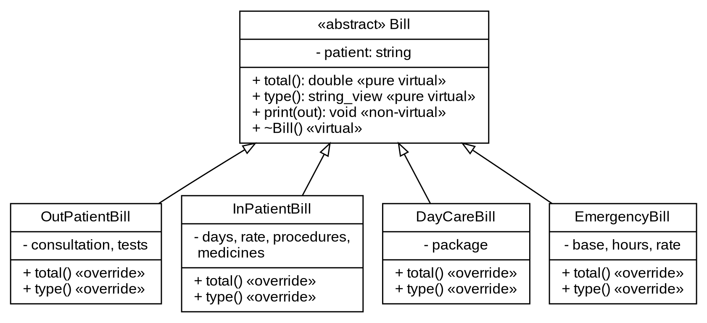

## A1 Polymorphic Bill Hierarchy

### A1.1 Common interface

A Bill stores a patient identifier. The full system would also store a unique bill ID and billing date for lookup and audit. Every bill supplies total() for its gross amount, type() for its category and print(out) for consistent display. The base class implements print(out) once and calls the virtual functions internally. The executable uses patient names as sample identifiers and rupees as the currency.

### A1.2 Abstract class and derived types



| Bill type | Total calculation |
| --- | --- |
| OutPatientBill | Consultation fee + tests |
| InPatientBill | Days × room rate + procedures + medicines |
| DayCareBill | Fixed surgery package price |
| EmergencyBill | Base charge + hours × hourly rate |

### A1.3 Daily total and switch alternative

```text
ALGORITHM TotalDailyBills(Bills, N)
INPUT: Bills, an array of N valid Bill references
OUTPUT: DailyTotal, the sum of all bill amounts
BEGIN
    DailyTotal ← 0
    FOR Index ← 0 TO N − 1 DO
        DailyTotal ← DailyTotal + Bills[Index].total()
    END FOR
    RETURN DailyTotal
END
```

An empty list yields zero. The loop visits every bill once and uses O(1) additional space, so time is O(n). A tagged record could store Type and the charge fields. A CASE on Type would select the matching formula for each element. That also takes O(n) time and O(1) extra accumulation space. With fixed-size bills, each representation uses O(1) space per bill. Separate classes store only their own fields plus typical vptr overhead. A tagged record stores a tag and either enough space for every field or a union sized for the largest case. A new derived class supplies its two overrides and is registered at creation. The tagged design requires a new tag and updates to all switches that interpret it.
