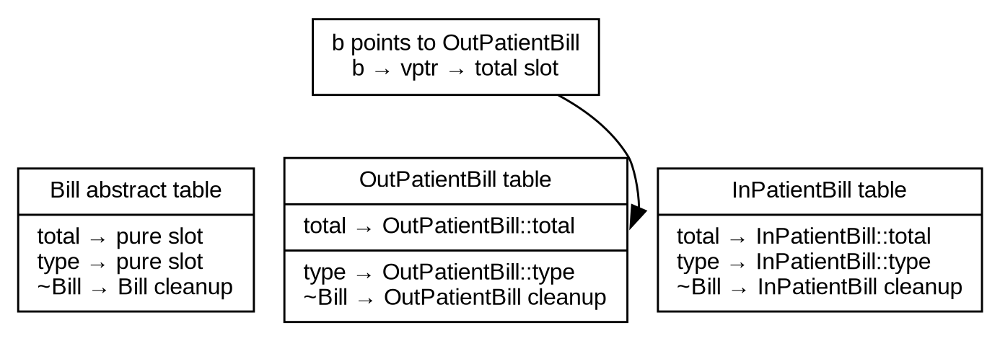
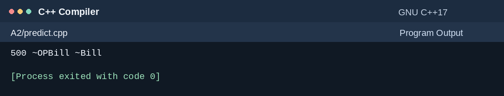
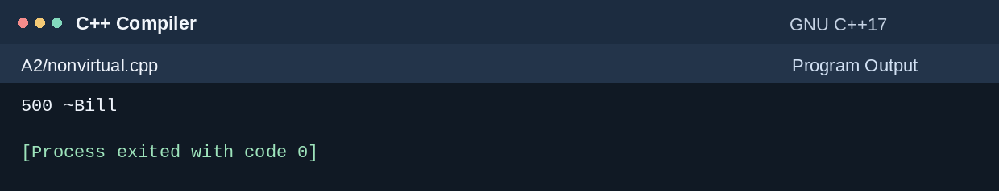
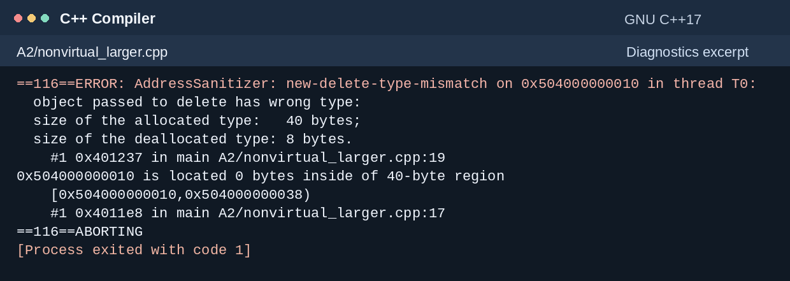

## A2 Runtime Binding

### A2.1 Early and late binding

For a Bill* b that points to an OutPatientBill, a call to b->print(out) selects Bill::print from the static type at compile time. Inside print, the call to total() uses the dynamic type. It resolves to OutPatientBill::total() for an out-patient object and InPatientBill::total() for an in-patient object. The assignment's show() works the same way when it calls total() on an OPBill.

### A2.2 Virtual tables and dispatch



Compilers commonly store a hidden vptr in each polymorphic object. A call through b uses that pointer to look up the slot for total and passes b as the implicit this argument. In a simple single-inheritance setup, the tables are shared by objects of the same dynamic class. A2 uses OPBill in the small prediction program, which corresponds to the out-patient example in the diagram.

### A2.3 Destruction through a base pointer

Deleting a derived object through a Bill* requires a virtual base destructor. It starts with the derived destructor and then destroys the base portion. Without it, ordinary deletion through Bill* in this example has undefined behavior. A vptr can still exist because total() remains virtual.

```text
500 ~OPBill ~Bill \n
```

The line above is the prediction recorded before running. Here \n denotes a newline and the space immediately before it is part of the program output. The run matched it exactly.



For the non-virtual version there is no portable exact prediction. The compiler also required removing override from ~OPBill. The exact edit printed 500 and ~Bill with a trailing space and exited 0 on this build. ASan reported no error in that equal-size example. A second run added storage to OPBill and ASan detected an allocation/deallocation size mismatch of 40 versus 8 bytes. The two runs illustrate why a quiet sanitizer pass alone cannot establish defined behavior.




A cast-based alternative tries dynamic_cast<OutPatientBill*>(b), then the other derived types until one succeeds, and calls that class's non-virtual calculation. This may require up to k type tests for k bill types, versus one virtual dispatch. RTTI costs are implementation-dependent. dynamic_cast still needs a polymorphic base for these downcasts, so keeping a virtual destructor typically retains the per-object vptr, commonly one pointer on this target.
