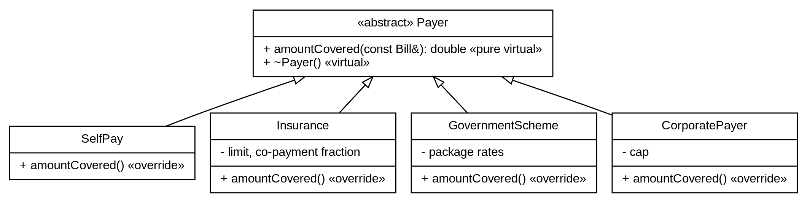

## A3 Abstract Payer Design

### A3.1 Coverage policies

| Policy | Coverage |
| --- | --- |
| SelfPay | Third-party coverage is zero. Patient pays the full gross. |
| Insurance | Requested coverage = gross × (1 − co-payment fraction). Reject above the policy limit. |
| GovernmentScheme | Use the fixed rate for the bill's package key and cap payment at the gross. Reject an unknown key. |
| CorporatePayer | Gross × 0.75, capped at the corporate limit. |

### A3.2 Adding a payer

CorporatePayer implements amountCovered(const Bill&) and holds its own cap. A caller passes it to the same function that accepts a Payer reference. No existing Payer or Bill class needs an edit. The sample uses bill type as the government package key. In a real deployment, multiple procedures of the same type would have distinct package codes.

A callable alternative stores std::function<double(const Bill&)> with a lambda capturing limit and copay by value. A function pointer needs a separate policy state or context argument. For fixed rules, each has O(1) call time and O(1) per instance. A virtual payer stores a typical vptr and the policy fields. A std::function stores a callable wrapper and may allocate for a larger capture. A government rate table uses O(p) space for p packages in either design, with average O(1) hash lookup and O(p) worst case.
