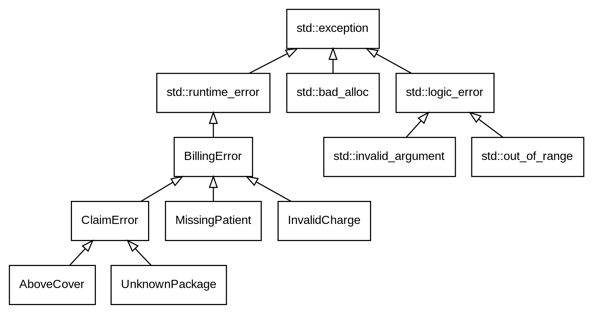

## A4 Exception Strategy

### A4.1 Error taxonomy

| Condition | Exception |
| --- | --- |
| Negative, non-finite or overflowing charge, or negative stay length | InvalidCharge |
| Requested coverage exceeds policy | AboveCover |
| Unsupported package in the scheme | UnknownPackage |
| Empty identifier or failed patient lookup | MissingPatient |
| Invalid numeric text or out-of-range numeric input | std::invalid_argument or std::out_of_range from parsing |
| Invalid co-payment fraction | ClaimError |
| Allocation failure | std::bad_alloc |

### A4.2 Exception specifications

Constructors, input parsing, claim validation and output can throw. Validate arithmetic at construction so total(), type() and patient() can be noexcept on established objects. SelfPay and CorporatePayer override amountCovered() with noexcept because their validated inputs need only fixed arithmetic. The shared Payer interface permits a throw. Destructors are noexcept. An exception leaving a destructor during unwinding can call std::terminate, so put recoverable write/close checks in an explicit operation.

A return-code alternative returns an enum and writes the amount through an output parameter. After each call, the caller checks the enum and returns the same failure upward if needed. For d layers, propagating a status is O(d) and a thrown exception can also unwind up to d frames, with extra handler lookup and cleanup costs. Result codes add a check on the normal route and typically O(1) payload storage at each layer that holds a result. Exception handling can avoid those repeated normal-path checks. Both designs incur the same required cleanup for live resources. Status codes are practical for routine rejection, especially when they preserve the reason.
