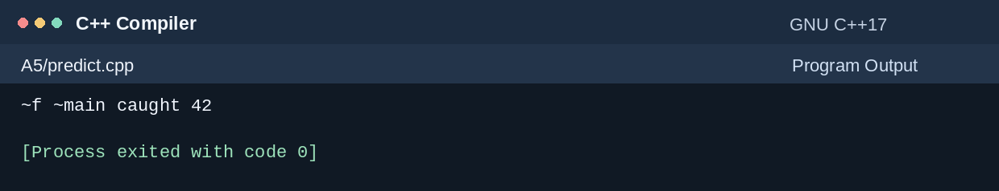

## A5 Recovery and Rethrowing

### A5.1 Catch locations

The input boundary catches parsing and missing-patient errors, identifies the offending record and allows corrected input. The settlement layer catches ClaimError to audit it, then uses throw; to preserve the original exception. The request handler catches the specific failure, reports the reason and marks the claim pending. It retains the bill before trying a payer and updates the settlement only after success. At the outer boundary, catch std::bad_alloc by reference and fall back to a minimal message and safe continuation where possible. A final catch (...) protects the per-request loop after rollback or safe abandonment.

### A5.2 Stack unwinding and resource ownership

When an exception leaves a scope, already constructed automatic objects are destroyed in reverse order. Use std::unique_ptr for heap ownership, a vector for an owned bill collection and fstream for files. Use an explicit commit step after a successful claim. RAII cleans up resources, while the data transaction controls what becomes permanent.

```text
~f ~main caught 42\n
```

The prediction was recorded before execution and matched. Guard f is in the innermost scope and is destroyed first. Guard main is destroyed as control exits the try block. The int handler matches 42, then execution reaches the newline. The statement after f() is skipped because f() throws.



With raw pointers, each success exit and exceptional exit must delete the resources already acquired or delegate to shared cleanup. With r resources, cleanup time remains O(r). With s independent exit paths, manual cleanup may repeat up to O(rs) deletion statements. One newly added path creates one additional unchecked exit and can omit as many as r deletions. RAII binds each resource to its owner once, so adding a new exception path adds zero manual deletion sites.
